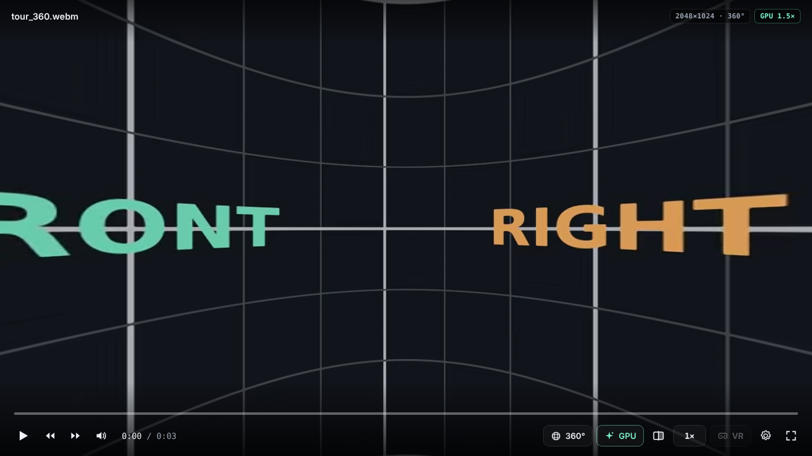

<p align="center"></p>

# Lumen VR Player

<p align="center"></p>

A desktop video player for **Windows, macOS, Linux and Debian/Ubuntu** that plays normal, 3D and VR video and improves picture quality with **real-time GPU upscaling** or **AI super-resolution**.

| | |
|---|---|
| **Formats** | 2D · 3D side-by-side / top-bottom (full or half) · 360° mono/stereo · VR180 (equirect) · 180° fisheye |
| **VR** | Look-around on a monitor (drag / wheel) · red-cyan anaglyph · real headsets via **WebXR / OpenXR** (SteamVR, Meta Quest Link & Air Link, Windows Mixed Reality, Pico Connect, Varjo…) · 3D movies on a virtual cinema screen |
| **Upscaling** | **GPU**: edge-adaptive Lanczos upscale + contrast-adaptive sharpening (FSR 1.0 algorithm), real time even for 8K VR · **AI**: any ONNX super-resolution model (Real-ESRGAN, Compact, SPAN…) on WebGPU, with CPU fallback |
| **Extras** | A/B compare slider · format auto-detection from filenames (`_360_TB`, `_180_LR`, `HSBS`, `fisheye`…) and remembered per file · drag-and-drop · "Open with…" file associations · keyboard shortcuts · stats overlay |

---

## Download

**Windows: one command (PowerShell):**

```powershell
irm https://raw.githubusercontent.com/unknownleaves/lumen-vr-player/main/install.ps1 | iex
```

This downloads the latest installer, installs it for your user (no admin needed), adds Start-menu and desktop shortcuts, and launches the app. To get the portable `.exe` instead, save `install.ps1` and run `powershell -ExecutionPolicy Bypass -File .\install.ps1 -Portable`.

Or grab an installer from the **[Releases page](https://github.com/unknownleaves/lumen-vr-player/releases)**:

| System | File |
|---|---|
| Windows | `Lumen VR Player Setup x.y.z.exe` (installer) or `…portable.exe` |
| macOS | `.dmg` (Intel and Apple Silicon) |
| Debian / Ubuntu | `.deb`: `sudo apt install ./lumen-vr-player_*.deb` |
| Other Linux | `.AppImage`: `chmod +x` it, then run it |

### Updates

The app checks GitHub Releases at startup and every 6 hours. You can turn this off in **Settings → Updates**, or check by hand from **File → Check for Updates…**.

| Install type | What happens |
|---|---|
| Windows installer, Linux AppImage, Linux `.deb` | Downloads in the background. Click **Restart & update**, or it installs the next time you quit. |
| macOS, Windows portable, Linux `.tar.gz` | Shows a notice with a **Download** button for the new version. macOS can only update itself if the app is code-signed. |

### Publishing a new version

```bash
git tag v1.0.1
git push origin v1.0.1
```

GitHub Actions builds every installer, stamps it with the tag's version, and publishes a release with the update files (`latest*.yml`, `*.blockmap`). Installed copies see the new version within a few hours, or right away with **Check now**.

## Screenshots

| A/B compare (original \| enhanced) | Settings |
|---|---|
|  |  |

## Quick start (run from source)

Requirements: **Node.js 20+** (https://nodejs.org).

```bash
cd lumen-vr-player
npm install
npm start
```

Open a video with **O**, the *Open video* button, or by dropping it on the window.

## Build installers

```bash
npm run dist:win     # Windows  → dist/*.exe (installer + portable), x64 & ARM64
npm run dist:mac     # macOS    → dist/*.dmg + .zip, universal (Intel + Apple Silicon)
npm run dist:linux   # Linux    → AppImage, .deb, .rpm, .tar.gz (x64 & ARM64)
npm run dist:deb     # Debian / Ubuntu / Mint / Pop!_OS → .deb only
```

Build each platform on that platform (or in CI using a matrix of `windows-latest`, `macos-latest`, `ubuntu-latest`). The macOS build is unsigned unless you set `CSC_LINK` / `APPLE_ID` credentials. On first launch of an unsigned build, right-click the app → *Open*.

Install the Debian package with:

```bash
sudo apt install ./dist/lumen-vr-player_1.0.0_amd64.deb
```

## Using it

| Key | Action |
|---|---|
| `Space` / `K` | Play / pause |
| `←` `→` / `J` `L` | Seek 5 s / 10 s |
| `,` `.` | Step one frame back/forward |
| `↑` `↓` · `M` | Volume · mute |
| `F` / double-click | Fullscreen |
| `P` | Cycle video format (2D → 3D → 360° → 180°…) |
| `U` | Cycle upscaling: Off → GPU → AI |
| `C` | A/B compare original vs enhanced (drag the divider) |
| `V` | Enter / exit VR headset |
| Drag · mouse wheel | Look around · zoom (360°/180° videos) |
| `R` | Recenter |
| `[` `]` | Playback speed |
| `I` · `S` · `?` | Stats · settings · help |

In a headset: **trigger** plays/pauses and **grip** recenters.

### Upscaling modes

**GPU (default).** Each frame is upscaled with an edge-direction-aware Lanczos filter, then sharpened with RCAS. Both follow AMD's open FidelityFX Super Resolution 1.0 algorithm. *Auto* scale matches your screen resolution, or the headset's pixel density in VR. The cost is a few milliseconds per frame, so it works on 8K 360° video.

**AI super-resolution.** This mode runs a neural network on the frame using ONNX Runtime Web (WebGPU on Windows/macOS/Linux with Vulkan, with a CPU fallback). Neural upscalers are far heavier than shaders, so there are two ways to apply it:

* **When paused (default):** the frame is upscaled at full quality in tiles, and you see the result appear tile by tile. Use it to inspect or screenshot a scene.
* **Live while playing:** the player keeps showing the most recent finished AI frame. On a strong GPU with a lightweight model and a low-resolution source (≤ 720p), this gives a usable live picture. For high-resolution VR, use GPU mode.

When the AI is busy or no model is loaded, the player falls back to GPU mode automatically.

### Getting an AI model

The app loads any ONNX image super-resolution model with **input `[1,3,H,W]` RGB 0–1 → output `[1,3,H·s,W·s]`** (float32 or float16, dynamic or fixed size).

The recommended model is **Real-ESRGAN compact** (`realesr-general-x4v3` for real footage, `realesr-animevideov3` for animation). It is small (≈1–5 MB) and fast:

1. Download the `.pth` from the Real-ESRGAN releases page: https://github.com/xinntao/Real-ESRGAN/releases
2. Convert it:
   ```bash
   pip install torch onnx
   python tools/export_onnx.py realesr-general-x4v3.pth realesr-general-x4v3.onnx --conv 32
   python tools/export_onnx.py realesr-animevideov3.pth  realesr-animevideov3.onnx  --conv 16
   ```
3. In the app, go to **Settings → AI model → Models folder**, drop the `.onnx` in, and pick it from the list. You can also use **Browse…**, or drag the `.onnx` onto the window.

Ready-made ONNX files from OpenModelDB / Hugging Face also work if they match the input/output layout above. Models placed in the repo's `models/` folder are bundled into the installers.

## VR headset notes

* **Windows** has the best support. Start your OpenXR runtime (SteamVR, Meta Quest Link/Air Link, WMR, Pico Connect, Virtual Desktop with its OpenXR runtime) **before** launching the app. The **VR** button lights up when a headset is detected.
* **Linux:** headset support depends on Chromium's OpenXR support, which is limited (Monado may work). Look-around and anaglyph viewing work everywhere.
* **macOS:** there is no PC-VR runtime, so you get desktop look-around and anaglyph viewing.
* 2D and 3D movies in a headset play on a large virtual screen. 3D movies show true stereo.

## Codecs

Playback uses Chromium's decoders with hardware acceleration where available: **H.264, H.265/HEVC** (hardware decoder required; standard on Windows 10/11 and Macs), **VP8/VP9, AV1**, AAC/Opus/MP3 audio, in MP4/MOV/WebM, and most MKVs. Files using other codecs (e.g. ProRes, DTS audio) need converting first. For example:

```bash
ffmpeg -i input.mkv -c:v copy -c:a aac output.mp4
```

## Project layout

```
main.js            Electron main process: window, app:// protocol with range streaming, dialogs, file associations
preload.js         Safe bridge between UI and OS (context-isolated, sandboxed)
lib/serve.js       File streaming with HTTP Range support (fast seeking in multi-GB VR files)
src/index.html     UI
src/app.js         Player logic, controls, AI scheduling
src/gl.js          WebGL2 pipeline: EASU upscale → RCAS sharpen → projection (flat/360/180/fisheye, mono/SBS/TB, anaglyph, compare)
src/xr.js          WebXR headset rendering
src/ai.js          ONNX Runtime Web tiled super-resolution (fp32/fp16, dynamic or fixed shapes)
src/detect.js      Format detection from filename and aspect ratio
tools/export_onnx.py  Real-ESRGAN .pth → .onnx converter
test/unit.test.mjs Unit tests (npm test)
```

The `src/` folder also runs in a plain browser for development: `npx serve .` and open `/src/index.html`. In a browser, files open through the file picker or drag-and-drop.

## Known limitations

* AI upscaling of high-resolution VR video (4K+) cannot run in real time on consumer hardware. Use it on paused frames, or use GPU mode.
* There is no export / "render upscaled video to file" yet. A natural next step would be to drive the same pipeline frame by frame into an encoder.
* Not supported: YouTube EAC cubemaps, Apple MV-HEVC spatial video, and subtitles.

License: MIT. The upscaling shaders implement the algorithm of AMD FidelityFX Super Resolution 1.0 (MIT).
