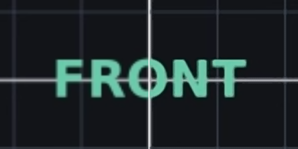
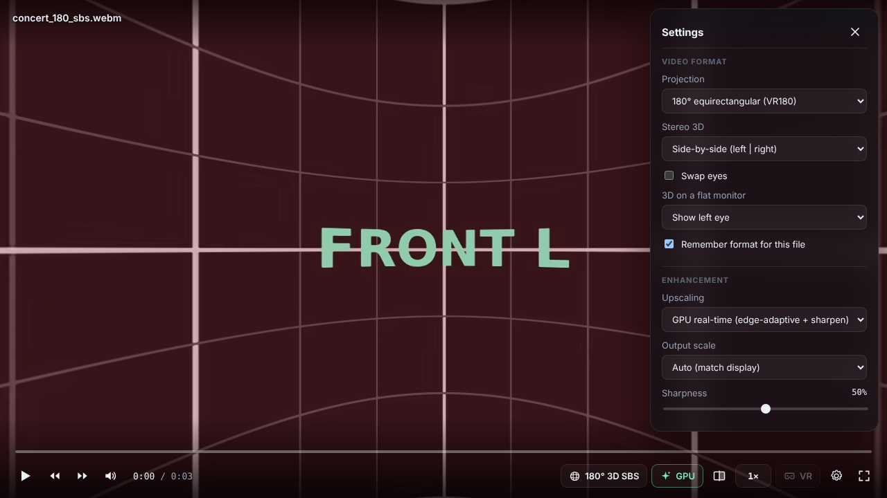

<p align="center"></p>

# Lumen VR Player

<p align="center"></p>

A desktop video player for **Windows, macOS, Linux and Debian/Ubuntu** that plays normal, 3D and VR video and improves picture quality with **real-time GPU upscaling** or **AI super-resolution**.

| | |
|---|---|
| **Files** | Any common video: MP4, MKV, AVI, WMV, MOV, WebM, MPEG-TS/M2TS, MPG/VOB, FLV, 3GP… with any codec (H.264, HEVC, AV1, VP9, MPEG-2, DivX/Xvid, WMV, VC-1…) and audio (AAC, AC3, E-AC3, DTS, FLAC…). Files the browser engine can't play are converted on the fly by FFmpeg. |
| **Playlists** | Queue with next / previous, **repeat one**, **repeat all**, **shuffle**, drag-to-reorder · saved, named playlists (on the server they're shared between all your devices) · play / shuffle / queue a whole folder |
| **VR formats** | 2D · 3D side-by-side / top-bottom (full or half) · 360° mono/stereo · VR180 (equirect) · 180° fisheye. Detected from filename tags or the video's own VR metadata |
| **VR** | Look-around on a monitor (drag / wheel) · red-cyan anaglyph · real headsets via **WebXR / OpenXR** (SteamVR, Meta Quest Link & Air Link, Windows Mixed Reality, Pico Connect, Varjo…) · 3D movies on a virtual cinema screen |
| **Upscaling** | **GPU**: edge-adaptive Lanczos upscale + contrast-adaptive sharpening (FSR 1.0 algorithm), real time even for 8K VR · **AI**: any ONNX super-resolution model (Real-ESRGAN, Compact, SPAN…) on WebGPU, with CPU fallback |
| **Extras** | A/B compare slider · format auto-detection from filenames (`_360_TB`, `_180_LR`, `HSBS`, `fisheye`…) and remembered per file · drag-and-drop · "Open with…" file associations · keyboard shortcuts · stats overlay |

---

## Download

**Windows: one command (PowerShell):**

```powershell
irm https://raw.githubusercontent.com/unknownleaves/lumen-vr-player/main/install.ps1 | iex
```

This downloads the latest installer, installs it for your user (no admin needed), adds Start-menu and desktop shortcuts, and launches the app. To get the portable `.exe` instead, save `install.ps1` and run `powershell -ExecutionPolicy Bypass -File .\install.ps1 -Portable`.

Or grab an installer from the **[Releases page](https://github.com/unknownleaves/lumen-vr-player/releases)**:

| System | File |
|---|---|
| Windows | `Lumen VR Player Setup x.y.z.exe` (installer) or `…portable.exe` |
| macOS | `.dmg` (Intel and Apple Silicon) |
| Debian / Ubuntu | `.deb`: `sudo apt install ./lumen-vr-player_*.deb` |
| Other Linux | `.AppImage`: `chmod +x` it, then run it |

### Updates

The app checks GitHub Releases at startup and every 6 hours. You can turn this off in **Settings → Updates**, or check by hand from **File → Check for Updates…**.

| Install type | What happens |
|---|---|
| Windows installer, Linux AppImage, Linux `.deb` | Downloads in the background. Click **Restart & update**, or it installs the next time you quit. |
| macOS, Windows portable, Linux `.tar.gz` | Shows a notice with a **Download** button for the new version. macOS can only update itself if the app is code-signed. |

### Android signing

The APK is signed with a private key stored in two repository secrets, `ANDROID_KEYSTORE_BASE64` and `ANDROID_KEYSTORE_PASSWORD` (Settings → Secrets and variables → Actions). Without them the APK is skipped and the rest of the release still builds. Keep a backup of the key: Android only accepts updates signed with the same key.

### Publishing a new version

Raise `"version"` in `package.json` (e.g. `1.0.0` → `1.0.1`) and push to `main`. If there's no release for that version yet, GitHub Actions publishes one automatically. Running **Actions → Build installers → Run workflow** with a version number, or pushing a `v1.0.1` tag, does the same.

GitHub Actions builds every installer, stamps it with the tag's version, and publishes a release with the update files (`latest*.yml`, `*.blockmap`). Installed copies see the new version within a few hours, or right away with **Check now**.

## Android

Download **`Lumen-VR-Player-x.y.z.apk`** from the [Releases page](https://github.com/unknownleaves/lumen-vr-player/releases/latest) on your phone, open it, and allow "Install unknown apps" for your browser when Android asks. Updates show up inside the app: tap **Download**, then open the new APK.

* **Open videos** plays files stored on the phone. It handles the formats Android can decode itself (MP4, WebM, and on most phones MKV with H.264/HEVC).
* **Connect to server** links the app to your ZimaOS server (enter its address, e.g. `192.168.1.50`). You can then browse its library, play any format (the server converts what the phone can't play), and share playlists with your other devices.
* Pinch to zoom, drag to move around, and tilt or turn the phone to look around 360°/180° videos. The Back button closes panels first.

## ZimaOS / NAS server (Docker)

The server edition runs on your NAS and streams your video folders to any browser on your network: PC, phone, TV, or the **Meta Quest browser for full VR**. It uses the same player, GPU upscaling and AI upscaling (the upscaling runs on the viewing device).

**ZimaOS:**
1. Open the ZimaOS dashboard, click **+** (top right of the apps) → **Install a customized app**.
2. Click the **Import** icon (top right of the dialog) and paste the contents of [`zimaos/docker-compose.yml`](zimaos/docker-compose.yml).
3. Check the **Volumes**. `/media` points to `/DATA/Media`; change it to wherever your videos are. Then click **Install**.
4. Open the app from the dashboard, or go to `http://<zimaos-ip>:8095`.

**VR headsets** (Quest, Pico…): open `https://<zimaos-ip>:8445` in the headset's browser. The first time, choose *Advanced → Proceed* to accept the server's own certificate. Open a video and press the **VR** button. Browsers only allow VR on secure (https) pages.

Set `LUMEN_PASSWORD` to require a password (user name `lumen`). Put `.onnx` AI models in `/DATA/AppData/lumen-vr-player/models`.

**Updating:** each release also publishes `ghcr.io/unknownleaves/lumen-vr-player:latest`. On ZimaOS, open the app's settings and use **Check then update** (or reinstall); the image is re-pulled. Any other Docker host works too:

```bash
docker run -d --name lumen-vr-player -p 8095:8080 -p 8445:8443 \
  -v /path/to/videos:/media:ro -v lumen-config:/config ghcr.io/unknownleaves/lumen-vr-player:latest
```

## Screenshots

| A/B compare (original \| enhanced) | Settings |
|---|---|
|  |  |

## Quick start (run from source)

Requirements: **Node.js 20+** (https://nodejs.org).

```bash
cd lumen-vr-player
npm install
npm start
```

Open a video with **O**, the *Open video* button, or by dropping it on the window.

## Build installers

```bash
npm run dist:win     # Windows  → dist/*.exe (installer + portable), x64 & ARM64
npm run dist:mac     # macOS    → dist/*.dmg + .zip, universal (Intel + Apple Silicon)
npm run dist:linux   # Linux    → AppImage, .deb, .rpm, .tar.gz (x64 & ARM64)
npm run dist:deb     # Debian / Ubuntu / Mint / Pop!_OS → .deb only
```

Build each platform on that platform (or in CI using a matrix of `windows-latest`, `macos-latest`, `ubuntu-latest`). The macOS build is unsigned unless you set `CSC_LINK` / `APPLE_ID` credentials. On first launch of an unsigned build, right-click the app → *Open*.

Install the Debian package with:

```bash
sudo apt install ./dist/lumen-vr-player_1.0.0_amd64.deb
```

## Using it

| Key | Action |
|---|---|
| `Space` / `K` | Play / pause |
| `Backspace` / Home button | Back to the start screen to pick another video (Continue watching · Recently played) |
| `←` `→` / `J` `L` | Seek 5 s / 10 s |
| `,` `.` | Step one frame back/forward |
| `↑` `↓` · `M` | Volume · mute |
| `N` · `B` | Next · previous video |
| `H` · `T` | Shuffle · repeat (off → all → one) |
| `Q` | Queue & playlists |
| `F` / double-click | Fullscreen |
| `P` | Cycle video format (2D → 3D → 360° → 180°…) |
| `U` | Cycle upscaling: Off → GPU → AI |
| `C` | A/B compare original vs enhanced (drag the divider) |
| `V` | Enter / exit VR headset |
| Mouse wheel · drag | **2D:** zoom in/out toward the pointer · drag to move around the zoomed picture. **360°/180°:** zoom · look around |
| `+` `−` · `0` | Zoom in / out · reset zoom (or click the zoom badge) |
| `Shift` + arrows | Move around while zoomed |
| `R` | Recenter |
| `[` `]` | Playback speed |
| `I` · `S` · `?` | Stats · settings · help |

In a headset: **trigger** plays/pauses and **grip** recenters.

### Upscaling modes

**GPU (default).** Each frame is upscaled with an edge-direction-aware Lanczos filter, then sharpened with RCAS. Both follow AMD's open FidelityFX Super Resolution 1.0 algorithm. *Auto* scale matches your screen resolution, or the headset's pixel density in VR. The cost is a few milliseconds per frame, so it works on 8K 360° video.

**AI super-resolution.** This mode runs a neural network on the frame using ONNX Runtime Web (WebGPU on Windows/macOS/Linux with Vulkan, with a CPU fallback). Neural upscalers are far heavier than shaders, so there are two ways to apply it:

* **When paused (default):** the frame is upscaled at full quality in tiles, and you see the result appear tile by tile. Use it to inspect or screenshot a scene.
* **Live while playing:** the player keeps showing the most recent finished AI frame. On a strong GPU with a lightweight model and a low-resolution source (≤ 720p), this gives a usable live picture. For high-resolution VR, use GPU mode.

When the AI is busy or no model is loaded, the player falls back to GPU mode automatically.

### Getting an AI model

The app loads any ONNX image super-resolution model with **input `[1,3,H,W]` RGB 0–1 → output `[1,3,H·s,W·s]`** (float32 or float16, dynamic or fixed size).

The recommended model is **Real-ESRGAN compact** (`realesr-general-x4v3` for real footage, `realesr-animevideov3` for animation). It is small (≈1–5 MB) and fast:

1. Download the `.pth` from the Real-ESRGAN releases page: https://github.com/xinntao/Real-ESRGAN/releases
2. Convert it:
   ```bash
   pip install torch onnx
   python tools/export_onnx.py realesr-general-x4v3.pth realesr-general-x4v3.onnx --conv 32
   python tools/export_onnx.py realesr-animevideov3.pth  realesr-animevideov3.onnx  --conv 16
   ```
3. In the app, go to **Settings → AI model → Models folder**, drop the `.onnx` in, and pick it from the list. You can also use **Browse…**, or drag the `.onnx` onto the window.

Ready-made ONNX files from OpenModelDB / Hugging Face also work if they match the input/output layout above. Models placed in the repo's `models/` folder are bundled into the installers.

## VR headset notes

* **Windows** has the best support. Start your OpenXR runtime (SteamVR, Meta Quest Link/Air Link, WMR, Pico Connect, Virtual Desktop with its OpenXR runtime) **before** launching the app. The **VR** button lights up when a headset is detected.
* **Linux:** headset support depends on Chromium's OpenXR support, which is limited (Monado may work). Look-around and anaglyph viewing work everywhere.
* **macOS:** there is no PC-VR runtime, so you get desktop look-around and anaglyph viewing.
* 2D and 3D movies in a headset play on a large virtual screen. 3D movies show true stereo.

## Formats & conversion

Each file is checked with FFmpeg when it opens:

* **Plays directly:** MP4/MOV/WebM with H.264, VP9, AV1 (and HEVC where the device has a hardware decoder). Seeking is instant and nothing extra runs.
* **Re-wrapped on the fly:** e.g. MKV/AVI/TS with H.264 or HEVC video. The picture is copied untouched and only incompatible audio (AC3, DTS…) is converted. This is cheap.
* **Converted on the fly:** old or unusual video codecs (MPEG-2, DivX/Xvid, WMV/VC-1…) are converted to H.264. This uses more CPU, especially at 4K. Seeking restarts the conversion from the new point, which takes a second.

The desktop app includes FFmpeg (the Debian package uses the system `ffmpeg`), and the Docker image includes it too. FFmpeg is a separate program licensed under the GPL (https://ffmpeg.org).

## Project layout

```
main.js            Electron main process: window, app:// protocol with range streaming, dialogs, file associations
preload.js         Safe bridge between UI and OS (context-isolated, sandboxed)
lib/serve.js       File streaming with HTTP Range support (fast seeking in multi-GB VR files)
src/index.html     UI
src/app.js         Player logic, controls, AI scheduling
src/gl.js          WebGL2 pipeline: EASU upscale → RCAS sharpen → projection (flat/360/180/fisheye, mono/SBS/TB, anaglyph, compare)
src/xr.js          WebXR headset rendering
src/ai.js          ONNX Runtime Web tiled super-resolution (fp32/fp16, dynamic or fixed shapes)
src/detect.js      Format detection from filename and aspect ratio
tools/export_onnx.py  Real-ESRGAN .pth → .onnx converter
test/unit.test.mjs Unit tests (npm test)
```

The `src/` folder also runs in a plain browser for development: `npx serve .` and open `/src/index.html`. In a browser, files open through the file picker or drag-and-drop.

## Troubleshooting playback

Press **I** while a video plays to show the stats overlay. It lists the file's codecs, how it's being played (`direct`, `remux` or `transcode`, and the encoder used), and how many frames were dropped. The player also fixes common problems by itself:

* **No picture** (the video's codec isn't supported by the graphics driver, e.g. some HEVC/Dolby Vision MP4s): it switches to conversion and continues from the same point.
* **Dropped frames**: AI upscaling steps down to GPU upscaling, then GPU upscaling switches off for that video (press **U** to turn it back on).
* **Conversion can't keep up**: it lowers the conversion resolution (1080p → 720p → 480p).

Conversion uses the graphics card's video encoder when there is one (NVIDIA NVENC, Intel Quick Sync, AMD AMF, Apple VideoToolbox), otherwise the CPU.

## Known limitations

* AI upscaling of high-resolution VR video (4K+) cannot run in real time on consumer hardware. Use it on paused frames, or use GPU mode.
* There is no export / "render upscaled video to file" yet. A natural next step would be to drive the same pipeline frame by frame into an encoder.
* Not supported: YouTube EAC cubemaps, Apple MV-HEVC spatial video, and subtitles.

License: MIT. The upscaling shaders implement the algorithm of AMD FidelityFX Super Resolution 1.0 (MIT).
